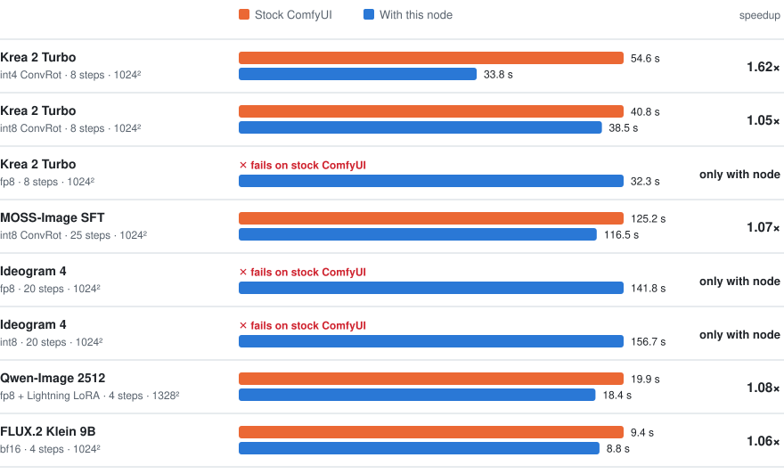
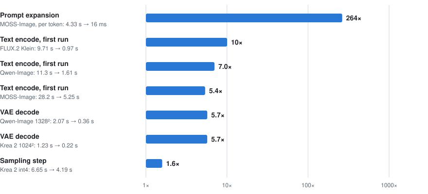
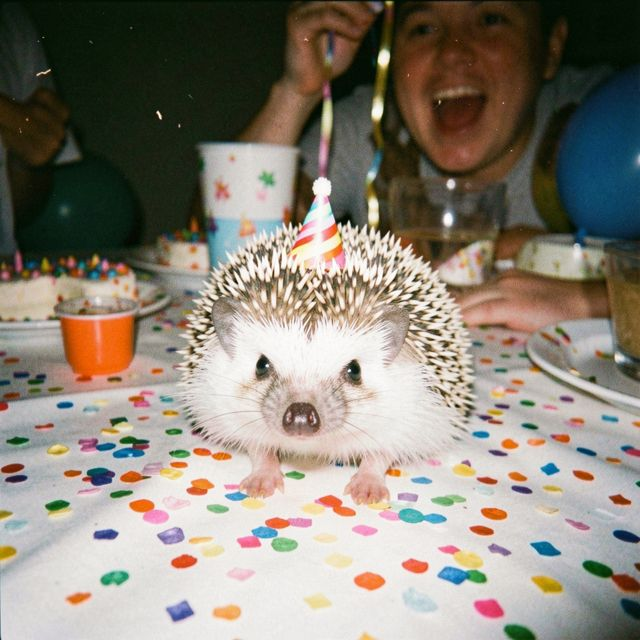

# Benchmarks

Stock ComfyUI vs ComfyUI with this node, on eight popular image workloads. Each one uses the
settings, prompt and seed from its official ComfyUI template.

Apple M5 Max, 128 GB, macOS 27.0.1, ComfyUI 0.42.0, PyTorch 2.11, node 1.4.0.

- **fp8 Krea 2 and both Ideogram 4 checkpoints fail on stock ComfyUI** on Apple Silicon
  (`Trying to convert Float8_e4m3fn to the MPS backend`). They run with the node.
- **Prompt expansion is 264× faster.** MOSS-Image's TextGenerate takes 4.3 s per token
  on stock ComfyUI, which runs text encoders on the CPU, and 16 ms per token with the node,
  which runs them on the GPU and generates through MLX.
- **VAE decode is up to 5.7× faster and the first text encode
  5 to 10× faster.**
- **Whole images are 1.05 to 1.62× faster** on the models that also run on stock.

## Time per image

Seconds per image with models already loaded. Each row is scaled to its own slowest bar.

<picture>
  <source media="(prefers-color-scheme: dark)" srcset="docs/benchmarks/time-per-image-dark.svg">
  
</picture>

| Model | Setup | Stock | With node | Speedup |
|---|---|---:|---:|---:|
| Krea 2 Turbo | int4 ConvRot, 8 steps, 1024² | 54.6 | 33.8 | 1.62× |
| Krea 2 Turbo | int8 ConvRot, 8 steps, 1024² | 40.8 | 38.5 | 1.05× |
| Krea 2 Turbo | fp8, 8 steps, 1024² | fails | 32.3 | only with node |
| MOSS-Image SFT | int8 ConvRot, 25 steps, 1024² | 125.2 | 116.5 | 1.07× |
| Ideogram 4 | fp8, 20 steps, 1024² | fails | 141.8 | only with node |
| Ideogram 4 | int8, 20 steps, 1024² | fails | 156.7 | only with node |
| Qwen-Image 2512 | fp8 + Lightning LoRA, 4 steps, 1328² | 19.9 | 18.4 | 1.08× |
| FLUX.2 Klein 9B | bf16, 4 steps, 1024² | 9.4 | 8.8 | 1.06× |

## Where the time goes

Most of the gain is outside the sampler. Speedup per stage, log scale:

<picture>
  <source media="(prefers-color-scheme: dark)" srcset="docs/benchmarks/stages-dark.svg">
  
</picture>

| Stage | Workload | Stock | With node | Speedup |
|---|---|---:|---:|---:|
| Prompt expansion | MOSS-Image, Qwen3.5-9B, per token | 4.33 s | 16 ms | 264× |
| Text encode, first run | FLUX.2 Klein, Qwen3-8B | 9.71 s | 0.97 s | 10× |
| Text encode, first run | Qwen-Image, Qwen2.5-VL-7B | 11.3 s | 1.61 s | 7.0× |
| Text encode, first run | MOSS-Image, Qwen3.5-9B | 28.2 s | 5.25 s | 5.4× |
| VAE decode | Qwen-Image, 1328² | 2.07 s | 0.36 s | 5.7× |
| VAE decode | Krea 2, 1024² | 1.23 s | 0.22 s | 5.7× |
| Sampling step | Krea 2 int4 | 6.65 s | 4.19 s | 1.6× |

## Samples

Generated with the node during the runs above.

<table>
<tr>
<td width="25%"> <b>Krea 2 Turbo</b> int4 ConvRot, 33.8 s</td>
<td width="25%"> <b>Krea 2 Turbo</b> int8 ConvRot, 38.5 s</td>
<td width="25%"> <b>Krea 2 Turbo</b> fp8, 32.3 s</td>
<td width="25%"> <b>MOSS-Image SFT</b> int8 ConvRot, 116.5 s</td>
</tr>
<tr>
<td width="25%"> <b>Ideogram 4</b> fp8, 141.8 s</td>
<td width="25%"> <b>Ideogram 4</b> int8, 156.7 s</td>
<td width="25%"> <b>Qwen-Image 2512</b> fp8 + Lightning LoRA, 18.4 s</td>
<td width="25%"> <b>FLUX.2 Klein 9B</b> bf16, 8.8 s</td>
</tr>
</table>

## How it was measured

- Each block starts a fresh headless ComfyUI server (stock, or with the node), runs the workload
  once cold and twice warm, then shuts down. Stock and node blocks alternate and repeat, so both
  sides see the same thermal state and background load.
- Times are medians of four warm runs. Run-to-run spread was under 2%.
- Prompt expansion is reported per token because sampled outputs differ in length
  (314 tokens on stock, 294 with the node).
- Same-seed images match in composition and quality. Quantized kernels shift fine detail, as any
  backend change does.
- Don't add `--use-pytorch-cross-attention` on Apple Silicon: ComfyUI's default sub-quadratic
  attention was faster here (Ideogram 4 1.49× and MOSS-Image 1.11× slower with the flag).
